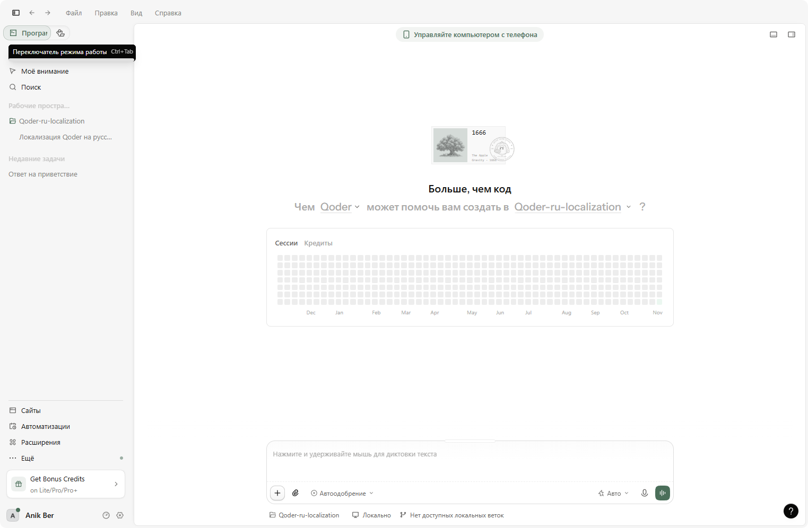

<p align="center">
  <strong>-------></strong>
  <a href="/README.ru.md">Russian</a> |
  <a href="/README.md">English</a> |
  <a href="/README.es.md">Spanish</a> |
  <a href="/README.zh.md">Chinese</a> |
  <strong><-------</strong>
</p>

# Localización al ruso de Qoder Desktop

Localización no oficial al ruso (ru-RU) de **Qoder Desktop** (Electron, Windows
x64). La aplicación oficial solo incluye chino e inglés; este proyecto añade una
interfaz completa en ruso: chat, sugerencias del compositor, ajustes, menús,
diálogos y la ventana de actualización — unas 10 200 cadenas traducidas.



## Correspondencia de versiones

**Cada versión del localizador corresponde a una versión exacta de Qoder.** Esta
versión es para **Qoder 0.5.5**.

Qoder guarda las cadenas de la interfaz en `resources\app.asar`, y cada
actualización reemplaza ese archivo, eliminando la localización. Por eso el
instalador comprueba `resources\build-manifest.json` y se niega a ejecutarse en
otra versión de Qoder. Tras actualizar Qoder, descargue el instalador de la nueva
versión desde [Releases](../../releases) y ejecútelo de nuevo.

## Instalación

1. Cierre Qoder por completo, incluido el icono de la bandeja.
2. Descargue el archivo de [Releases](../../releases)
   (`qoder-ru-localization-0.5.5-windows-x64.zip`), descomprímalo y ejecute
   **`QoderRU-Setup-0.5.5.exe`**.
3. La carpeta de Qoder se detecta automáticamente → pulse
   **«Установить русский»**.
4. Inicie Qoder: la interfaz estará en ruso.

Si la interfaz sigue en inglés, abra *Ajustes → Apariencia → Idioma* y elija
**Русский**.

El instalador no descarga nada ni requiere clave API: las traducciones están
incluidas en el ejecutable.

## Reversión

Pulse **«Откатить»** en el instalador. Restaura `resources\app.asar` desde la
copia de seguridad y devuelve el hash de integridad original en `Qoder.exe`.

## Notas

- El proyecto no redistribuye archivos de Qoder; modifica la instalación local y
  crea antes una copia de seguridad.
- No está afiliado a Qoder. Úselo bajo su propio riesgo.
- Algunos nombres de marca y textos promocionales del servidor permanecen en
  inglés.

## Compilar

Windows con el compilador de .NET Framework 4.x:

```bat
Build.bat
```

## Licencia

MIT — consulte [LICENSE](LICENSE).
