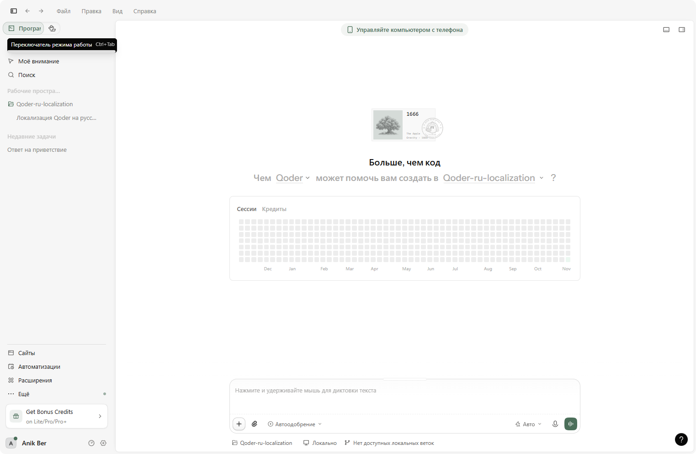

<p align="center">
  <strong>-------></strong>
  <a href="/README.ru.md">Russian</a> |
  <a href="/README.md">English</a> |
  <a href="/README.es.md">Spanish</a> |
  <a href="/README.zh.md">Chinese</a> |
  <strong><-------</strong>
</p>

# Qoder Desktop Russian Localization

Unofficial Russian (ru-RU) localization for **Qoder Desktop** (Electron, Windows
x64). The official app ships with Chinese and English only; this project adds a
full Russian interface: chat, composer hints, settings, menus, dialogs and the
update window — about 10,200 translated strings plus runtime translation of
server-delivered texts.



## Version matching

**A localization release always matches one exact Qoder version.** Releases
exist for **Qoder 0.5.5 and Qoder 0.5.7** — pick the one for your version.

Qoder keeps its interface strings inside `resources\app.asar`, and every update
replaces that file — which removes the localization. That is why the installer
checks `resources\build-manifest.json` and refuses to run on a different Qoder
version instead of risking a broken UI. After updating Qoder, download the
installer for the new version from [Releases](../../releases) and run it again.

## Installation

1. Fully quit Qoder, including the tray icon.
2. Download the archive from the [Releases](../../releases) page
   (`qoder-ru-localization-<version>-windows-x64.zip` for your Qoder version),
   unpack it and run **`QoderRU-Setup-<version>.exe`**.
3. The Qoder folder is detected automatically (you can pick it manually) →
   click **«Установить русский»**.
4. Start Qoder — the interface is in Russian.

If the interface is still English, open *Settings → Appearance → Language* and
select **Русский**.

The installer does not download anything and needs no API key: all translations
are embedded in the executable at build time.

## Rollback

Click **«Откатить»** in the installer. It restores `resources\app.asar` from the
backup created during installation and returns the integrity hash in
`Qoder.exe` to its original value, so the installation is byte-identical to the
original again.

## What is translated

- Main window, sidebar, composer, hints and tooltips
- Settings, language menu and all option descriptions
- Chat states, queued messages, "Steer", model picker descriptions
- The Qoder update dialog (install / update later / install and restart)
- Runtime replacement of known server-delivered English strings

Some items intentionally stay in English: product and model brand names,
server-side promotional banners, and a few date labels.

## Build from source

Requirements: Windows and the .NET Framework 4.x compiler (already included in
Windows).

```bat
Build.bat
```

The script reads `QODER_VERSION.txt`, embeds
`data\ru-translated-<version>.json`, `data\ru-extra-ui.json` and the version
marker into `install\QoderRuSetup.cs`, and produces
`QoderRU-Setup-<version>.exe`.

## Notes

- The project does not redistribute Qoder binaries. The installer patches the
  user's local installation and creates a backup first.
- Not affiliated with Qoder or its developers. Use at your own risk.
- Translation quality can vary; corrections via issues are welcome.

## License

MIT — see [LICENSE](LICENSE).
