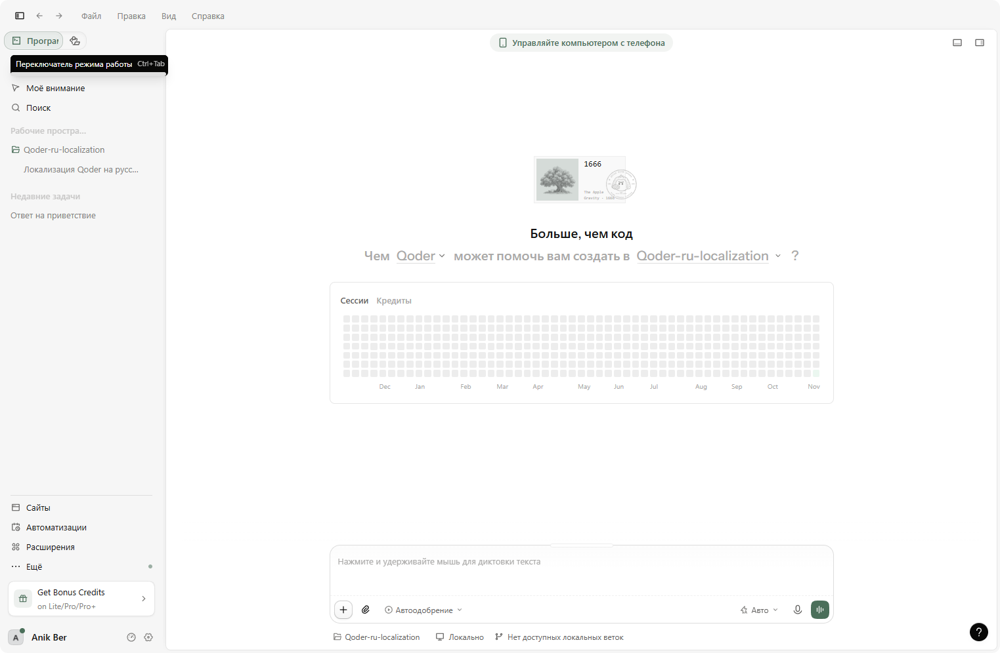

<p align="center">
  <strong>-------></strong>
  <a href="/README.ru.md">Russian</a> |
  <a href="/README.md">English</a> |
  <a href="/README.es.md">Spanish</a> |
  <a href="/README.zh.md">Chinese</a> |
  <strong><-------</strong>
</p>

# Русификатор Qoder Desktop

Неофициальная русская локализация (ru-RU) для **Qoder Desktop** (Electron,
Windows x64). Официально программа поставляется только с китайским и
английским языком; этот проект добавляет полноценный русский интерфейс: чат,
подсказки в поле ввода, настройки, меню, диалоги и окно обновления — около
10 200 переведённых строк плюс перевод серверных текстов на лету.



## Совпадение версий

**Релиз русификатора всегда соответствует одной конкретной версии Qoder.**
Этот релиз предназначен для **Qoder 0.5.5**.

Строки интерфейса Qoder хранятся внутри `resources\app.asar`, и каждое
обновление заменяет этот файл — вместе с ним пропадает локализация. Поэтому
установщик сверяет версию в `resources\build-manifest.json` и отказывается
работать с другой версией Qoder, чтобы не сломать интерфейс. После обновления
Qoder скачайте установщик для новой версии со страницы
[Releases](../../releases) и запустите его снова.

## Установка

1. Полностью закройте Qoder, включая значок в трее.
2. Скачайте архив со страницы [Releases](../../releases)
   (`qoder-ru-localization-0.5.5-windows-x64.zip`), распакуйте и запустите
   **`QoderRU-Setup-0.5.5.exe`**.
3. Папка Qoder определится автоматически (можно выбрать вручную) → нажмите
   **«Установить русский»**.
4. Запустите Qoder — интерфейс на русском.

Если интерфейс остался английским, откройте *Настройки → Внешний вид → Язык* и
выберите **Русский**.

Установщик ничего не скачивает и не требует API-ключа: все переводы встроены в
исполняемый файл на этапе сборки.

## Откат

Нажмите **«Откатить»** в установщике. Он восстановит `resources\app.asar` из
резервной копии, созданной при установке, и вернёт исходный хеш целостности в
`Qoder.exe`, поэтому установка снова станет побайтно идентична оригиналу.

## Что переведено

- Главное окно, боковая панель, поле ввода, подсказки и всплывающие подсказки
- Настройки, меню языков и описания всех параметров
- Состояния чата, очередь сообщений, «Steer», описания моделей
- Окно обновления Qoder (установить / обновить позже / установить и перезапустить)
- Замена известных английских серверных строк во время работы

Часть элементов намеренно остаётся на английском: бренды продуктов и моделей,
серверные промо-баннеры и некоторые подписи дат.

## Сборка из исходников

Требования: Windows и компилятор .NET Framework 4.x (уже входит в Windows).

```bat
Build.bat
```

Скрипт читает `QODER_VERSION.txt`, встраивает
`data\ru-translated-<версия>.json`, `data\ru-extra-ui.json` и маркер версии в
`install\QoderRuSetup.cs` и создаёт `QoderRU-Setup-<версия>.exe`.

## Примечания

- Проект не распространяет файлы Qoder. Установщик правит локальную установку
  пользователя и сначала создаёт резервную копию.
- Проект не связан с Qoder и его разработчиками. Используйте на свой риск.
- Качество перевода может различаться; исправления через issues приветствуются.

## Лицензия

MIT — см. [LICENSE](LICENSE).
