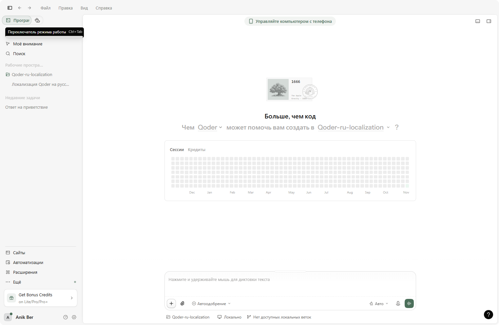

<p align="center">
  <strong>-------></strong>
  <a href="/README.ru.md">Russian</a> |
  <a href="/README.md">English</a> |
  <a href="/README.es.md">Spanish</a> |
  <a href="/README.zh.md">Chinese</a> |
  <strong><-------</strong>
</p>

# Qoder Desktop 俄语本地化

**Qoder Desktop**（Electron，Windows x64）的非官方俄语（ru-RU）本地化。官方版
仅提供中文和英文；本项目添加完整俄语界面：聊天、输入框提示、设置、菜单、
对话框和更新窗口，约 10 200 条已翻译字符串。



## 版本对应

**每个本地化版本都严格对应一个 Qoder 版本。** 本版本适用于 **Qoder 0.5.5**。

Qoder 的界面字符串位于 `resources\app.asar`，每次更新都会替换该文件并导致
本地化失效。因此安装程序会检查 `resources\build-manifest.json`，拒绝在其他
Qoder 版本上运行，以免破坏界面。更新 Qoder 后，请从
[Releases](../../releases) 下载对应新版本的安装程序并重新运行。

## 安装

1. 完全退出 Qoder（包括托盘图标）。
2. 从 [Releases](../../releases) 下载
   `qoder-ru-localization-0.5.5-windows-x64.zip`，解压并运行
   **`QoderRU-Setup-0.5.5.exe`**。
3. 程序会自动检测 Qoder 目录（也可手动选择），点击
   **«Установить русский»**。
4. 启动 Qoder，界面即为俄语。

如果界面仍为英文，请打开 *设置 → 外观 → 语言* 并选择 **Русский**。

安装程序不联网，也不需要 API 密钥：所有翻译在构建时已嵌入可执行文件。

## 回滚

在安装程序中点击 **«Откатить»**。它会从备份恢复 `resources\app.asar`，并将
`Qoder.exe` 中的完整性哈希恢复为原值。

## 说明

- 本项目不重新分发 Qoder 文件；安装程序修改本地安装并预先创建备份。
- 与 Qoder 官方无关，使用风险自负。
- 部分品牌名称、服务器推送的推广内容和少量日期标签仍为英文。

## 从源码构建

需要 Windows 和 .NET Framework 4.x 编译器：

```bat
Build.bat
```

## 许可证

MIT — 参见 [LICENSE](LICENSE)。
